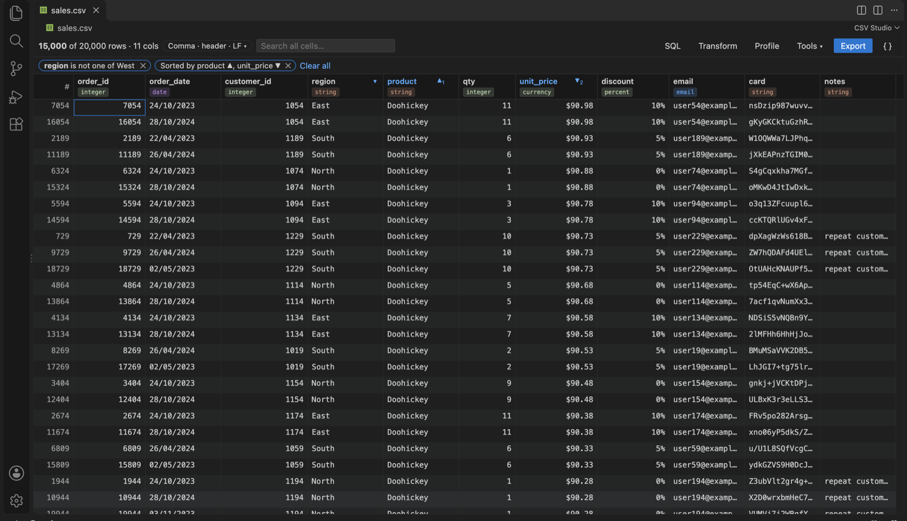
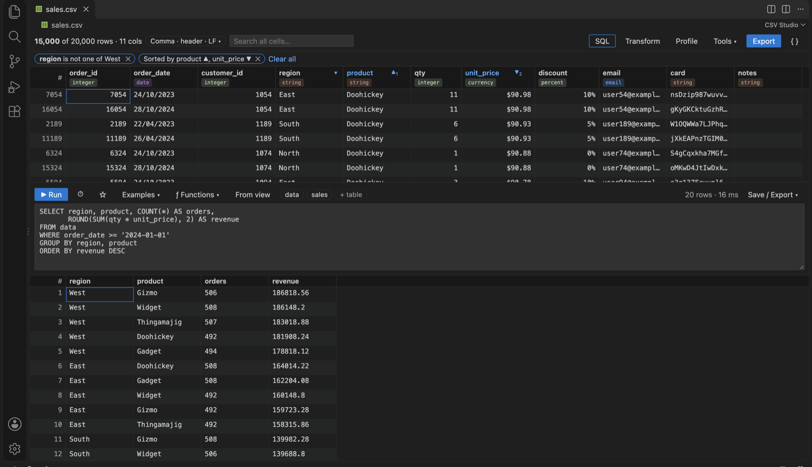
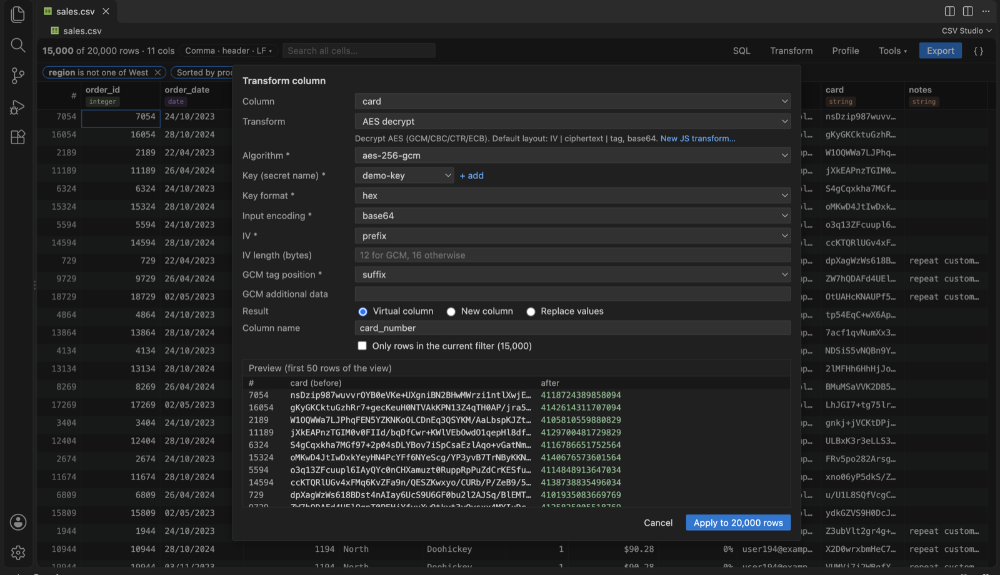
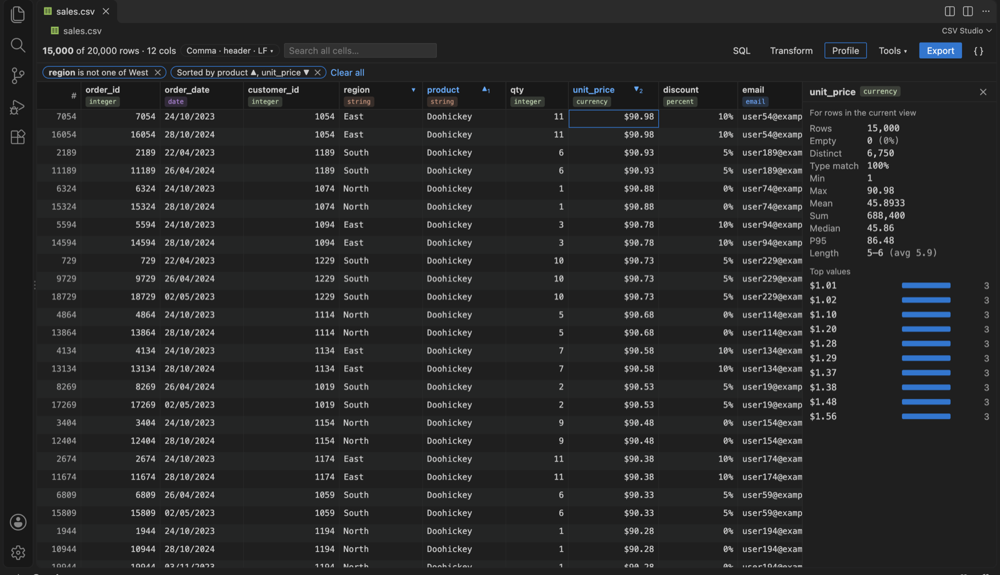

# CSV Studio

A Swiss Army knife for CSV in VS Code. You get a typed grid to view and edit data, Excel-style filters, multi-column sorting, **SQL queries**, **column transforms including decryption**, column profiles, lint and repair, comparison, split and merge, and export to almost anything.

For a guided tour, read the blog post [CSV Studio: Query, Filter and Decrypt CSV Files Without Leaving VS Code](https://rizwanansari.net/csv-studio-query-filter-and-decrypt-csv-files-without-leaving-vs-code/).



## Open it

- Click the split-view icon in the editor title bar of any `.csv` / `.tsv` / `.psv` file (**Open CSV Studio to the Side**).
- Or right-click a file in the Explorer and choose **Open in CSV Studio**, or use **Reopen Editor With… → CSV Studio**.
- To make it the default, add `"workbench.editorAssociations": { "*.csv": "csvStudio.editor" }` to your settings.

CSV Studio edits the real file. A cell edit rewrites only that field, so the rest of the file stays exactly as it was: quoting, delimiter and line endings are unchanged. Undo, save and git work normally. Keep the text editor open beside it and the two stay in sync.

## Features

### Grid and column types
- A virtualized grid that stays smooth with hundreds of thousands of rows. Columns can be resized, dragged to reorder, hidden and frozen, and long text can wrap.
- **Column types are detected automatically:**
  - Numbers: integer, decimal (including `1.234,5`), percent, currency.
  - Dates: dates (ISO, `dd/mm/yyyy` and `mm/dd/yyyy` are told apart automatically) and datetimes.
  - Other: boolean, email, URL, UUID, JSON.
- Click a type badge to override it. Overrides are remembered per file.
- Types control sorting, filters and alignment, and how values are stored in SQL. Cells that don't match their column's type are underlined in red.
- Values with leading zeros (`007`) and numbers with more than 15 digits (card numbers, long IDs) are kept as text, so they never lose data.
- The delimiter, header row, BOM and line endings are detected automatically. The chip in the toolbar lets you read the file differently, for example with no header row or a semicolon delimiter.

### Filter, sort and search
- **Shift+click** column headers to sort by several columns. Empty values always sort last.
- The ⏷ button on each column opens a filter that matches the column's type:
  - Numbers and dates: `>`, `≥`, `<`, `≤`, `between`.
  - Text: contains, regex, starts with.
  - Any column: empty / not empty, or **only cells that don't match the column's type**.
- The same panel lists the column's **distinct values with counts**, with checkboxes, like Excel.
- Right-click any cell for **Filter to this value**, **Exclude this value**, and `≥` / `≤` this value.
- Filters and sorts show as chips you can remove. Global search covers every cell.
- **Tools → Apply current sort to file** makes the sort permanent.

### SQL queries
Open the **SQL** panel, or press ⌘⌥Q / Ctrl+Alt+Q. The file is an in-memory SQLite table called `data`, also available under its file name:

```sql
SELECT region, COUNT(*) AS orders, ROUND(SUM(qty * unit_price), 2) AS revenue
FROM data
WHERE order_date >= '2024-01-01'
GROUP BY region
ORDER BY revenue DESC
```



- Columns are stored as their detected types. `$1,200` becomes the number 1200, and dates become ISO text, so `strftime()` works.
- **+ table** (or **CSV Studio: Add Table from File…**) adds other CSV files as tables you can JOIN.
- Extra functions:
  - `REGEXP`, `regexp_replace`, `regexp_extract`.
  - Every transform below that has a SQL name: `decrypt(card, 'my-key')`, `mask(x, 0, 4)`, `hash(x)`, `jwt_payload(token)`, `b64decode(x)`…
  - Your own JavaScript transforms, as `js_<name>(x)`.
- Autocomplete, **Examples ▾** built from your actual columns, a **ƒ Functions** reference, history and saved queries.
- **From view** turns your current filters and sort into the equivalent SQL.
- Run with ⌘/Ctrl+Enter, or select text to run just part of the query.
- **Save / Export ▾** writes **all** result rows to a new CSV, JSON, YAML, Markdown, HTML or SQL file, or a new tab. It can also copy the result as TSV, or replace the file with it.

### Save results to another file
**Export** saves the current filtered and sorted view, or just the rows you selected (click and Shift/Cmd+click row numbers). You can export all columns or only the visible ones in display order, and choose:
- **Format:** CSV, TSV, JSON, NDJSON, YAML, Markdown, HTML or SQL `INSERT` statements.
- **CSV options:** delimiter, quoting (only when needed / all / non-numeric), header on or off, LF or CRLF.
- **Encoding:** UTF-8, UTF-8 with BOM (Excel-friendly), UTF-16 or Windows-1252.

### Column transforms, including decryption
Open **Transform** from the toolbar, a column header or a cell. Pick a column and a transform, and see a **live preview of 50 rows before and after**, including any per-row errors. Then write the result:
- **Virtual column:** shown in the grid and usable in SQL, but **never written to the file**. Ideal for decrypted data.
- **New column** next to the source column.
- **Replace values** in place (⌘Z undoes it).



| Group | Transforms |
|---|---|
| Crypto | **AES decrypt / encrypt** (GCM, CBC, CTR, ECB; key as hex, base64, UTF-8 or passphrase; IV taken from the start of the value, from another column, or a fixed value; GCM tag position and AAD), **Fernet decrypt**, hash and HMAC |
| Encoding | Base64, hex, URL encode/decode, gunzip/gzip + base64, **JWT decode** (payload, header or a single claim) |
| Text | Trim, case, find & replace, regex replace/extract, **mask** (`************1234`), combine columns with a template |
| Values | Reformat dates (auto-detects d/m/y, m/d/y, epoch), reformat numbers, fill down, default for empty cells |

**Keys and passwords:** run **CSV Studio: Set Secret…**. Secrets are stored in your OS keychain through VS Code's SecretStorage. They are never written to settings or files, and transforms refer to them only by name.

**Your own JavaScript:** run **CSV Studio: New JavaScript Transform…**. It creates `.vscode/csv-studio/transforms/<name>.js`, which you can keep in version control and share with your team:

```js
export const label = 'Decrypt legacy card';

export default function (value, row, ctx) {
  if (!value) return value;
  const key = helpers.deriveKey(ctx.secret('legacy-key'), 'hex', 'aes-256-cbc');
  const iv = Buffer.from(row.iv, 'hex');          // IV stored in another column
  return helpers.aesDecrypt(Buffer.from(value, 'base64'), { algorithm: 'aes-256-cbc', key, iv }).toString('utf8');
}
```

- The function gets `value`, `row` (the cells keyed by column name) and `ctx` (`rowIndex`, `secret(name)`, `state`), plus Node's `crypto`, `Buffer` and `helpers`.
- It runs in a separate context with **no `require`, file system, network or `eval`**, and with a time limit for each value.
- It is **not** a hard security sandbox. Transforms therefore only run in **trusted workspaces**, and each new or changed file must be approved once before it runs.
- Transforms that run synchronously can also be called from SQL as `js_<name>(value)`.

### Profile and data quality
- **Profile** shows, for the current view:
  - Counts: rows, empty (%), distinct.
  - Type match, with a shortcut to show only the invalid cells.
  - For numbers and dates: min, max, mean, median, P95, sum.
  - Text length range, and the top values with bars. Click a bar to filter to that value.



- **Lint:** ragged rows, unterminated quotes, blank lines, mixed line endings, duplicate or empty header names, and a trailing empty column. These appear in the Problems panel and as a banner.
- **Lint & Repair** shows a diff before it changes anything. It pads short rows, names extra columns, drops blank lines and fixes quoting.

### More tools (Tools ▾ or the Command Palette)
- **Edit:** insert, duplicate and delete rows (several at once). Rename, insert, move and delete columns. Clear cells.
- **Change delimiter / quoting / line endings:** rewrites the whole file.
- **Split file:** one file per value of a column, or every N rows.
- **Merge / append** several CSV files, matching columns by name, with an optional `source_file` column.
- **Compare with another CSV by key column(s):** lists added, removed and changed rows, with the before and after value of each changed cell.
- **Convert:** CSV to JSON (optionally turning `a.b` columns into nested objects), YAML, Markdown, HTML or SQL; and JSON to CSV.
- **Text editor:** rainbow-colored columns, the column name on hover, and `Row 12 · price` in the status bar.
- **Large files:** **Open Large CSV (Read-Only)** reads files from disk, including those over VS Code's 50 MB extension limit. Filtering, SQL, transforms (as virtual columns) and export all still work.

## Settings

| Setting | Default | |
|---|---|---|
| `csvStudio.rainbowColumns` | `true` | Colour columns in the text editor |
| `csvStudio.sqlPreviewLimit` | `10000` | Rows shown for a SQL result (export always writes every row) |
| `csvStudio.typeInferenceSample` | `100000` | Rows sampled to detect column types |
| `csvStudio.transformTimeoutMs` | `2000` | Time limit per value for JavaScript transforms |
| `csvStudio.queryHistorySize` | `30` | Number of recent SQL queries kept |

## Development

```bash
npm install
node test/fixtures/generate.mjs     # sales.csv (encrypted card column), customers.csv, broken.csv
npm run build                       # extension (esbuild) + webview (Vite)
npm test                            # unit tests (vitest)
npm run test:integration            # smoke tests inside VS Code
npm run package                     # build a .vsix
```

The fixtures' card column is encrypted with the demo key `000102…1e1f` (see `test/fixtures/generate.mjs`). Save it as the secret `demo-key`, then try `SELECT decrypt(card, 'demo-key') FROM data`.

Layout: `src/core` holds the pure, unit-tested logic (parser, dialect, types, view, edit, SQL, transforms, export, compare). `src/extension` is the VS Code host. `webview/` is the React UI.
